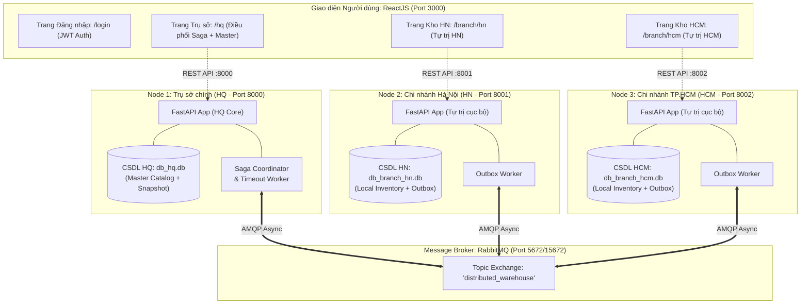

# CẨM NANG TOÀN DIỆN: KIẾN TRÚC, CÁCH TEST VÀ KỊCH BẢN BÁO CÁO ĐỒ ÁN HỆ THỐNG PHÂN TÁN
Học phần: Các hệ thống phân tán (Distributed Systems)
Hệ thống: Distributed Warehouse Management System (WMS)
Phiên bản kiến trúc: Đa Node (Multi-Node Cluster) + Phân tách Route & Phân quyền JWT/RBAC

---

## PHẦN 1: BẢN CHẤT VÀ KIẾN TRÚC HỆ THỐNG PHÂN TÁN

### 1.1. Hệ thống gồm những thành phần nào?
Hệ thống không phải là một khối mã nguồn đơn lẻ (Monolith) chạy chung một cơ sở dữ liệu, mà là Kiến trúc phân tán Microservices chia sẻ không gian lưu trữ độc lập (Shared-Nothing Architecture). Mỗi node sở hữu cơ sở dữ liệu SQLite riêng biệt và tiến trình chạy tách rời hoàn toàn.



1. Node Trụ sở chính (HQ Service - Port 8000):
   - Quản lý danh mục hàng hóa gốc (Master Data Catalog).
   - Đóng vai trò Saga Coordinator: Điều phối đơn điều chuyển hàng giữa các kho.
   - Lưu trữ bản chụp tồn kho toàn quốc (Global Read-Model Snapshot) theo mô hình CQRS để theo dõi toàn mạng lưới mà không cần truy vấn trực tiếp làm chậm CSDL của các chi nhánh.
   - Tiến trình Saga Timeout Worker tự động quét và xử lý đơn hàng bị treo quá 60 giây.

2. Node Chi nhánh Hà Nội (Branch HN - Port 8001):
   - CSDL độc lập (`db_branch_hn.db`), bảng tồn kho cục bộ, sổ cái biến động riêng.
   - Tiến trình nền Outbox Worker riêng để phát tán sự kiện sang RabbitMQ.

3. Node Chi nhánh TP.HCM (Branch HCM - Port 8002):
   - CSDL độc lập (`db_branch_hcm.db`), bảng tồn kho cục bộ, sổ cái biến động riêng.
   - Tiến trình nền Outbox Worker riêng.

4. Message Broker (RabbitMQ - Port 5672 / 15672):
   - Kênh truyền thông điệp bất đồng bộ (Asynchronous Event-Driven) theo cơ chế Publish/Subscribe.
   - Loại bỏ sự phụ thuộc chặt chẽ (Tight Coupling) giữa các chi nhánh.

5. Giao diện Web ReactJS (Port 3000):
   - Phân tách thành các Route độc lập: `/login`, `/hq`, `/branch/hn`, `/branch/hcm`.
   - Cơ chế bảo vệ tuyến đường (Route Guard & RBAC) ngăn chặn truy cập chéo trái phép.

---

### 1.2. Hệ thống Phân quyền Người dùng (RBAC) & Phân tách Route

Hệ thống áp dụng chuẩn xác thực JWT Bearer Token và phân quyền nghiệp vụ 3 cấp độ:

| Tài khoản | Mật khẩu | Vai trò (Role) | Chi nhánh | Tuyến đường được phép | Quyền hạn nghiệp vụ |
| :--- | :--- | :--- | :--- | :--- | :--- |
| `admin` | `admin123` | `HQ_MANAGER` | `HQ` | `/hq`, `/branch/hn`, `/branch/hcm` | Quản lý danh mục gốc (CRUD), phát lệnh điều chuyển Saga, giám sát toàn quốc, giả lập sự cố mạng. |
| `manager_hn` | `hn123` | `BRANCH_MANAGER` | `HN` | `/branch/hn` | Quản lý toàn diện kho HN: Duyệt/Từ chối kiện hàng đến, thiết lập Min/Max, kiểm kê tồn kho. |
| `manager_hcm` | `hcm123` | `BRANCH_MANAGER` | `HCM` | `/branch/hcm` | Quản lý toàn diện kho HCM: Duyệt/Từ chối kiện hàng đến, thiết lập Min/Max, kiểm kê tồn kho. |
| `staff_hn` | `staff123` | `BRANCH_STAFF` | `HN` | `/branch/hn` | Tác nghiệp tại chỗ kho HN: Xuất bán hàng, nhập hàng nhà cung cấp, đếm số lượng kiểm kê vật lý. |
| `staff_hcm` | `staff123` | `BRANCH_STAFF` | `HCM` | `/branch/hcm` | Tác nghiệp tại chỗ kho HCM: Xuất bán hàng, nhập hàng nhà cung cấp, đếm số lượng kiểm kê vật lý. |

Đặc điểm bảo vệ tuyến đường (RBAC Route Guard):
- Nếu người dùng chưa đăng nhập, hệ thống luôn bắt buộc chuyển về trang `/login`.
- Nếu nhân sự thuộc kho Hà Nội (`manager_hn` hoặc `staff_hn`) cố tình truy cập vào đường dẫn `/branch/hcm`, hệ thống lập tức chặn đứng và hiển thị màn hình `403 Forbidden - Quyền truy cập bị từ chối`.
- Quản trị viên Trụ sở (`admin`) có quyền đặc biệt được phép giám sát cả 2 chi nhánh thông qua nút "Giám sát" trên thanh công cụ.

---

### 1.3. Bảng đối chiếu các Nguyên lý Phân tán trong Đồ án

| Nguyên lý Phân tán | Ý nghĩa lý thuyết | Cách hệ thống thực thi trong thực tế |
| :--- | :--- | :--- |
| **Định lý CAP** | Không thể đạt đồng thời C, A, P trên mạng phân tán. | Chọn **AP (Availability & Partition Tolerance)** đi kèm **Eventual Consistency**. Không dùng giao thức khóa 2PC (Two-Phase Commit) vì 2PC sẽ khóa chết hệ thống khi có 1 node gặp sự cố. |
| **Saga Pattern (Orchestration)** | Quản lý giao dịch xuyên suốt nhiều CSDL độc lập mà không dùng khóa phân tán. | HQ đóng vai trò Orchestrator điều phối quy trình 3 bước: Kho nguồn tạm khóa hàng -> Kho đích xác nhận -> Kho nguồn trừ hẳn và kho đích cộng hàng. |
| **Compensating Transaction** | Giao dịch bù trừ hoàn tác khi bước sau bị thất bại. | Nếu kho đích từ chối nhận hoặc hết chỗ chứa, Saga Coordinator phát lệnh `CMD_RELEASE_STOCK` để kho nguồn tự giải phóng hàng tạm khóa, bảo toàn 100% số lượng. |
| **Outbox Pattern** | Đảm bảo tính nguyên tử (Atomic) giữa việc lưu CSDL và phát sự kiện ra Broker. | Ghi dữ liệu kho và sự kiện vào bảng `Outbox_Events` trong cùng một Local Transaction. Tiến trình nền `OutboxWorker` sau đó đọc bảng này để bắn sang RabbitMQ. |
| **Idempotency** | Tính bất biến: Xử lý một thông điệp nhiều lần vẫn cho kết quả đúng duy nhất. | Mỗi giao dịch mang một mã định danh duy nhất `reference_id`. Nếu nhận được gói tin bị gửi lại, CSDL kiểm tra trùng bảng sổ cái `Stock_Ledger` và bỏ qua ngay. |
| **Local Autonomy (Tự trị cục bộ)** | Node chi nhánh vẫn hoạt động độc lập khi mất kết nối với trung tâm. | Chi nhánh HN vẫn xuất bán hàng, nhập mua nhà cung cấp, kiểm kê kho bình thường ngay cả khi HQ hoặc kho HCM bị sụp đổ. |
| **Optimistic Locking** | Chống xung đột tranh chấp đồng thời (Race Condition) không cần khóa bảng. | Bảng `Local_Inventory` quản lý cột `version`. Khi 10 yêu cầu cùng trừ kho 1 lúc, request nào lệch version sẽ bị từ chối, triệt tiêu hoàn toàn lỗi âm kho. |

---

## PHẦN 2: HƯỚNG DẪN TEST THỰC HÀNH TỪNG BƯỚC ĐỂ NẮM BẢN CHẤT

### 2.1. Các đường dẫn truy cập cần mở sẵn
Mở trình duyệt web của bạn và mở các tab sau:
1. Giao diện ứng dụng: `http://localhost:3000`
2. RabbitMQ Management Dashboard: `http://localhost:15672` (Tài khoản: `guest` / Mật khẩu: `guest`)
3. API Swagger Node HQ: `http://localhost:8000/docs`
4. API Swagger Node HN: `http://localhost:8001/docs`
5. API Swagger Node HCM: `http://localhost:8002/docs`

---

### 2.2. Kịch bản Test 1: Đăng nhập phân quyền & Kiểm chứng Rào chắn RBAC Guard (403 Forbidden)
- Mục tiêu: Chứng minh hệ thống có cơ chế xác thực JWT độc lập và bảo vệ tuyến đường chuẩn doanh nghiệp, ngăn chặn truy cập chéo trái phép.
- Các bước thực hiện:
  1. Truy cập `http://localhost:3000`. Hệ thống tự động chuyển hướng đến trang `/login`.
  2. Bấm vào nút "Trưởng kho Hà Nội" (hoặc nhập `manager_hn` / `hn123`) và bấm "Đăng Nhập Hệ Thống".
  3. Quan sát: Hệ thống xác thực thành công và chuyển bạn thẳng đến trang `/branch/hn`. Giao diện thể hiện rõ vai trò `@manager_hn (BRANCH_MANAGER)`.
  4. Thử nghiệm kiểm thử xâm nhập (Security RBAC Test):
     - Trên thanh địa chỉ trình duyệt, sửa đường dẫn thành: `http://localhost:3000/branch/hcm` và gõ Enter.
  5. Hiện tượng quan sát:
     - Hệ thống không tải dữ liệu của kho HCM mà lập tức chặn lại bởi màn hình lỗi: `403 FORBIDDEN - QUYỀN TRUY CẬP BỊ TỪ CHỐI`.
     - Thông báo nêu rõ: Tài khoản thuộc chi nhánh HN, không có quyền xem hoặc thao tác trên kho HCM.
     - Bấm nút "Quay về Chi nhánh của bạn" -> Hệ thống đưa an toàn về lại `/branch/hn`.
  6. Bấm nút "Đăng xuất" góc trên bên phải để trở về màn hình đăng nhập.

---

### 2.3. Kịch bản Test 2: Khởi tạo Sản phẩm & Đồng bộ Danh mục gốc (Master Data Replication)
- Mục tiêu: Chứng minh Trụ sở phát sự kiện Master Data qua RabbitMQ, các chi nhánh tự động tiếp nhận và khởi tạo tồn kho đầu kỳ mà không cần can thiệp thủ công.
- Các bước thực hiện:
  1. Tại trang `/login`, bấm đăng nhập bằng "Trụ sở chính HQ" (`admin` / `admin123`).
  2. Hệ thống chuyển đến trang `/hq`.
  3. Tại khung "Quản Lý Danh Mục Hàng Hóa Gốc", bấm nút "Thêm Mặt Hàng Mới".
  4. Nhập thông tin sản phẩm:
     - Mã SKU: `MACBOOK-M3-PRO`
     - Tên hàng hóa: `Apple MacBook Pro 14 M3 Pro 18GB 512GB`
     - Đơn vị tính: `Chiếc`
     - Đơn giá: `49990000`
     - Tồn đầu kỳ Kho Hà Nội (HN): `40`
     - Tồn đầu kỳ Kho TP.HCM (HCM): `20`
     - Định mức tồn tối thiểu (Min): `5`
  5. Bấm "Tạo & Đồng Bộ Toàn Bộ Chi Nhánh".
- Hiện tượng quan sát:
  - Bảng Tổng quan tồn kho tại HQ lập tức ghi nhận dòng `MACBOOK-M3-PRO`: Tổng khả dụng = `60`, Kho HN = `40`, Kho HCM = `20`.
  - Trên thanh công cụ, bấm vào liên kết "Kho Hà Nội": Bạn thấy sản phẩm đã có mặt tại kho HN với số lượng `40 chiếc` và có bản ghi sổ cái INITIAL_STOCK.
  - Bấm tiếp liên kết "Kho TP.HCM": Sản phẩm cũng đã có mặt tại kho HCM với số lượng `20 chiếc`.

---

### 2.4. Kịch bản Test 3: Giao dịch điều chuyển phân tán Saga thành công (Happy Path)
- Mục tiêu: Chứng minh quy trình điều phối Saga 3 bước giữa 2 CSDL độc lập thông qua RabbitMQ.
- Các bước thực hiện:
  1. Tại màn hình `/hq` (đăng nhập bằng `admin`):
     - Tìm đến khung "Tạo Đơn Điều Chuyển Kho (Saga Coordinator)".
     - Kho nguồn: Chọn `Chi nhánh Hà Nội (HN)`
     - Kho đích: Chọn `Chi nhánh TP.HCM (HCM)`
     - Mặt hàng: Chọn `MACBOOK-M3-PRO`
     - Số lượng chuyển: `15`
  2. Bấm nút "Phát Lệnh Điều Chuyển (Initiate Saga)".
  3. Bấm mở cửa sổ "Nhật Ký Điều Chuyển (Saga Timeline)":
     - Đơn hàng mang mã ví dụ `SAGA-...` hiển thị màu vàng: `RESERVED_IN_TRANSIT` (Hàng đang trên đường đi).
  4. Kiểm tra số liệu kho:
     - Kho HN: Khả dụng giảm từ `40` xuống `25`, tạm khóa `15` (Reserved = 15).
     - Kho HCM: Khả dụng vẫn là `20` (vì hàng chưa nhập kho).
  5. Thực hiện tiếp nhận tại kho đích:
     - Bấm "Đăng xuất", đăng nhập bằng "Trưởng kho TP.HCM" (`manager_hcm` / `hcm123`).
     - Hệ thống đưa bạn vào trang `/branch/hcm`.
     - Cuộn xuống phần "Kiện Hàng Điều Chuyển Chờ Nhập Kho (Incoming Transfers)": Bạn sẽ thấy kiện hàng `15 chiếc MACBOOK-M3-PRO` đang ở trạng thái `CHO_DUYET`.
     - Bấm nút xanh "Xác Nhận Nhập Kho".
- Hiện tượng quan sát:
  - Kiện hàng chuyển sang trạng thái `DA_NHAP_KHO`.
  - Số dư tồn kho khả dụng của Kho HCM lập tức tăng từ `20` lên `35 chiếc`.
  - Đăng nhập lại vào `/hq`: Đơn Saga đổi sang màu xanh lá `COMPLETED`. Tại kho HN, số lượng tạm khóa trở về `0` và khả dụng giữ nguyên `25`.
  - Hai CSDL độc lập đã đạt trạng thái Nhất quán sau cùng (Eventual Consistency)!

---

### 2.5. Kịch bản Test 4: Giao dịch bù trừ hoàn tác Saga Rollback (Compensating Transaction)
- Mục tiêu: Đây là tính năng quan trọng nhất để đạt điểm tuyệt đối. Chứng minh khi kho đích gặp sự cố và từ chối nhận, hệ thống tự động giải phóng hàng tại kho nguồn mà không thất thoát một sản phẩm nào.
- Các bước thực hiện:
  1. Đăng nhập `admin` tại `/hq`:
     - Phát tiếp một lệnh điều chuyển: Chuyển `10` chiếc `MACBOOK-M3-PRO` từ `Chi nhánh Hà Nội (HN)` sang `Chi nhánh TP.HCM (HCM)`.
  2. Kiểm tra kho HN: Khả dụng còn `15`, tạm khóa tăng lên `10`.
  3. Đăng xuất, đăng nhập `manager_hcm` vào `/branch/hcm`:
     - Tại danh sách kiện hàng chờ nhập kho, tìm đến kiện hàng 10 chiếc vừa tới.
     - Giả sử phát hiện kiện hàng bị hư hỏng vỡ hộp hoặc kho HCM không còn chỗ chứa -> Bấm nút đỏ "Từ Chối Nhận".
     - Nhập lý do: `Bao bì rách hỏng do vận chuyển, từ chối nhận`.
- Hiện tượng quan sát:
  - Kho HCM lập tức phát sự kiện `EVT_TRANSFER_REJECTED` lên RabbitMQ.
  - Saga Coordinator tại HQ tiếp nhận và phát ngay lệnh bù trừ `CMD_RELEASE_STOCK` cho kho HN.
  - Kho HN nhận lệnh -> Tự động mở khóa `10` chiếc hoàn trả vào tồn khả dụng.
  - Số dư tồn kho khả dụng tại kho HN lập tức hồi phục trở lại đúng `25 chiếc`.
  - Đơn Saga tại HQ chuyển sang trạng thái `CANCELLED_ROLLED_BACK`.
  - Không có bất kỳ chiếc laptop nào bị mất hay bị khóa ảo!

---

### 2.6. Kịch bản Test 5: Tính Tự trị Cục bộ khi mất kết nối Trung tâm (Local Autonomy)
- Mục tiêu: Chứng minh khi Trụ sở HQ hoặc RabbitMQ tạm thời dừng, các chi nhánh vẫn bán hàng và hoạt động độc lập bình thường.
- Các bước thực hiện:
  1. Đăng nhập tài khoản `staff_hn` vào `/branch/hn`.
  2. Tại khung "Tác Nghiệp Kho Cục Bộ (Local Autonomy)":
     - Thử tab "Xuất Bán Hàng (Sale)": Xuất bán `5` chiếc `MACBOOK-M3-PRO` cho khách hàng lẻ.
     - Số tồn kho HN giảm ngay xuống `20`, sổ cái ghi nhận biến động SALE.
     - Thử tab "Nhập Hàng Nhà Cung Cấp (GRN)": Nhập mua thêm `10` chiếc từ Nhà phân phối Synnex FPT.
     - Số tồn kho HN lập tức tăng lên `30`.
     - Thử tab "Kiểm Kê Kho Thực Tế (Audit)": Thủ kho đếm thực tế tại kệ còn `28` chiếc (lệch 2 chiếc) -> Nhập số lượng đếm 28 -> Hệ thống tự sinh bút toán điều chỉnh ADJUSTMENT cân bằng tồn kho về 28.
- Ý nghĩa phân tán: Mọi thao tác đều thực thi cục bộ trên CSDL `db_branch_hn.db`, không hề bị phụ thuộc vào việc HQ có đang bật hay tắt.

---

### 2.7. Chạy các kịch bản Kiểm thử Tự động qua Terminal (Automation Test Suites)
Mở cửa sổ PowerShell và thực thi 5 bộ test tự động:
```powershell
Set-Location "C:\Users\Tien Loc\Downloads\Khohang_phantan"
$env:PYTHONIOENCODING="utf-8"

# 1. Kiểm thử luồng Saga điều chuyển thành công:
python tests/test_saga_happy_path.py

# 2. Kiểm thử giao dịch bù trừ Saga Rollback khi kho đích từ chối:
python tests/test_saga_rollback.py

# 3. Kiểm thử tranh chấp đồng thời 10 request chống âm kho (Optimistic Lock):
python tests/test_concurrency_race_condition.py

# 4. Kiểm thử toàn diện 7 tính năng nâng cao (JWT, Replication, Audit, Outbox):
python tests/test_new_enhancements.py

# 5. Kiểm thử CRUD danh mục và phân bổ tồn kho ban đầu:
python tests/test_crud_refinement.py
```
Kết quả: Tất cả các kịch bản đều in ra log tiếng Việt rõ ràng từng bước và kết luận PASSED 100%.

---

## PHẦN 3: KỊCH BẢN THUYẾT TRÌNH BÁO CÁO ĐỒ ÁN TRƯỚC HỘI ĐỒNG (5 - 7 PHÚT)

### 3.1. Lời mở đầu (1 phút)
"Kính thưa Thầy/Cô và các bạn đồng môn, hôm nay nhóm em xin phép báo cáo đồ án: Hệ thống Quản lý Kho hàng Phân tán Đa Chi nhánh (Distributed Warehouse Management System).

Trong thực tế doanh nghiệp bán lẻ quy mô toàn quốc, việc sử dụng kiến trúc nguyên khối Monolith với một cơ sở dữ liệu tập trung thường bộc lộ 3 điểm yếu chí mạng:
1. Điểm nghẽn sụp đổ duy nhất (Single Point of Failure): Khi máy chủ CSDL trung tâm gặp sự cố, toàn bộ chi nhánh cả nước đều ngừng hoạt động.
2. Độ trễ mạng cao khi các kho ở xa truy cập vào một database duy nhất.
3. Thiếu tính độc lập và tự trị giữa các vùng miền.

Để giải quyết triệt để vấn đề trên, hệ thống của nhóm em được thiết kế theo kiến trúc Microservices phân tán độc lập (Shared-Nothing):
- Giao diện Web ReactJS tách biệt các Route với cơ chế xác thực JWT và phân quyền RBAC.
- Gồm 3 node dịch vụ riêng biệt: Trụ sở chính HQ (Port 8000) và 2 Chi nhánh Hà Nội (Port 8001), TP.HCM (Port 8002), mỗi node sở hữu một cơ sở dữ liệu SQLite tách biệt.
- Kết nối bất đồng bộ thông qua Message Broker RabbitMQ theo mô hình Event-Driven.
- Áp dụng nguyên lý AP của Định lý CAP, đảm bảo tính Nhất quán sau cùng (Eventual Consistency) bằng Saga Pattern và Outbox Pattern."

---

### 3.2. Demo trực quan trên hệ thống (3 - 4 phút)
(Mở trình duyệt tại `http://localhost:3000`)

1. Điểm Demo 1: Phân tách Route độc lập và Phân quyền RBAC Guard
   "Trước tiên, em xin trình diễn tính năng xác thực và phân quyền. Thầy/Cô có thể thấy trên màn hình là trang đăng nhập `/login`.
   Hệ thống hỗ trợ các tài khoản riêng biệt cho từng chi nhánh:
   - Em đăng nhập bằng tài khoản Trưởng kho Hà Nội (`manager_hn`). Hệ thống đưa em về đúng trang quản trị `/branch/hn`.
   - Bây giờ, nếu nhân viên Hà Nội cố tình sửa URL để vào xem kho TP.HCM tại `/branch/hcm`, hệ thống lập tức kích hoạt RBAC Guard và chặn lại bằng lỗi 403 Forbidden. Điều này đảm bảo tính riêng tư và cách ly dữ liệu giữa các chi nhánh."

2. Điểm Demo 2: Master Data Replication & Tính Tự trị Cục bộ
   "Tiếp theo, em đăng nhập tài khoản `admin` tại trang Trụ sở `/hq`.
   Em khởi tạo một mặt hàng mới và chỉ định số lượng tồn ban đầu cho từng kho: 40 chiếc cho Hà Nội và 20 chiếc cho TP.HCM.
   Khi bấm Tạo, sự kiện được bắn qua RabbitMQ và được ghi nhận lập tức vào CSDL riêng của cả 2 chi nhánh.
   Tại mỗi chi nhánh, các nhân viên có thể xuất bán hàng, nhập hàng nhà cung cấp hoặc kiểm kê kho tại chỗ mà không hề bị phụ thuộc vào đường truyền mạng tới Trụ sở."

3. Điểm Demo 3: Điều phối Saga & Giao dịch bù trừ Hoàn tác (Trọng tâm bảo vệ)
   "Bây giờ là phần đặc sắc nhất của hệ thống phân tán: Điều chuyển kho liên chi nhánh.
   Vì kho HN và kho HCM dùng 2 database vật lý riêng biệt, ta không thể dùng lệnh BEGIN TRANSACTION truyền thống. Nhóm em đã cài đặt mô hình Saga Orchestration:
   - Tại HQ, em phát lệnh chuyển 10 sản phẩm từ HN vào HCM. Kho HN nhận lệnh và tạm khóa 10 sản phẩm này.
   - Khi kiện hàng tới HCM, nếu Trưởng kho HCM kiểm tra thấy kiện hàng bị ướt rách và bấm Từ Chối Nhận, kho HCM phát sự kiện EVT_TRANSFER_REJECTED.
   - Saga Coordinator tại HQ lập tức kích hoạt Giao dịch bù trừ (Compensating Transaction), phát lệnh CMD_RELEASE_STOCK yêu cầu kho HN tự động giải phóng 10 sản phẩm về lại tồn khả dụng.
   Như Thầy/Cô thấy trên màn hình, tồn kho HN lập tức hồi phục về đúng số lượng ban đầu, đơn hàng được đánh dấu Cancelled Rolled Back, hoàn toàn không có thất thoát hàng hóa!"

4. Điểm Demo 4: Chống tranh chấp đồng thời (Optimistic Concurrency Control)
   "Cuối cùng, để chống âm kho khi có nhiều khách hàng đặt mua cùng 1 thời điểm, nhóm em cài đặt Optimistic Locking với trường version. Kịch bản test tự động với 10 yêu cầu đồng thời đã chứng minh hệ thống chỉ chấp nhận đúng số lượng tồn thực tế và từ chối các request gây âm kho."

---

### 3.3. Lời kết (30 giây)
"Tổng kết lại, đồ án của nhóm em không chỉ giải quyết tốt nghiệp vụ quản lý kho mà đã giải quyết trọn vẹn các yêu cầu nghiêm ngặt của hệ thống phân tán: Tính chịu lỗi cao, Tính tự trị cục bộ, Tính nhất quán sau cùng và Tính bảo mật phân quyền. Nhóm em xin chân thành cảm ơn quý Thầy/Cô và rất mong nhận được các câu hỏi góp ý ạ!"

---

## PHẦN 4: BỘ CÂU HỎI PHẢN BIỆN CỦA HỘI ĐỒNG VÀ CÂU TRẢ LỜI XUẤT SẮC

### Câu hỏi 1: "Tại sao em không dùng Two-Phase Commit (2PC) mà lại chọn Saga Pattern?"
- Trả lời:
  "Dạ thưa Thầy/Cô, giao thức 2PC là cơ chế đồng bộ (Synchronous) và mang tính chất khóa tài nguyên (Blocking). Trong mô hình mạng diện rộng WAN giữa các chi nhánh Hà Nội và TP.HCM, nếu một chi nhánh bị rớt mạng hoặc phân vùng mạng (Network Partition) trong lúc đang Prepare, toàn bộ hệ thống sẽ bị treo cứng và khóa CSDL, vi phạm nghiêm trọng tính Sẵn sàng (Availability) của định lý CAP.
  Do đó, mô hình Saga bất đồng bộ (Asynchronous) kết hợp với Giao dịch bù trừ (Compensating Transaction) là tiêu chuẩn thực tế trong kiến trúc vi dịch vụ, giúp hệ thống vẫn hoạt động liên tục và đạt tính Nhất quán sau cùng (Eventual Consistency)."

### Câu hỏi 2: "Nếu kho đích bị sập nguồn hoặc mất mạng lâu dài khi hàng đang trên đường, hàng tạm khóa ở kho nguồn có bị kẹt mãi mãi không?"
- Trả lời:
  "Dạ không ạ. Nhóm em đã cài đặt tiến trình Saga Timeout Worker chạy ngầm định kỳ tại Trụ sở chính HQ. Nếu một đơn hàng ở trạng thái RESERVED_IN_TRANSIT quá 60 giây mà chi nhánh đích không có tín hiệu xác nhận hoặc từ chối, hệ thống coi đây là sự cố rớt mạng và tự động kích hoạt quy trình hoàn tác: phát lệnh CMD_RELEASE_STOCK giải phóng hàng cho kho nguồn và cập nhật đơn hàng thành CANCELLED_ROLLED_BACK ạ."

### Câu hỏi 3: "Nếu Message Broker gửi lại một thông điệp 2 lần (Duplicate Message) thì tồn kho có bị trừ 2 lần không?"
- Trả lời:
  "Dạ không ạ. Hệ thống cài đặt nguyên lý Idempotency (Tính bất biến). Mỗi giao dịch đều mang theo một Idempotency Key duy nhất là `reference_id`. Trong CSDL chi nhánh, bảng sổ cái `Stock_Ledger` đặt ràng buộc `UNIQUE` trên cột này. Khi nhận được gói tin bị gửi lại do mạng, CSDL sẽ bắt được lỗi trùng lặp khóa và bỏ qua ngay, không làm thay đổi số dư tồn kho lần thứ hai ạ."

### Câu hỏi 4: "Outbox Pattern trong đồ án giải quyết vấn đề gì?"
- Trả lời:
  "Dạ thưa Thầy/Cô, Outbox Pattern giải quyết triệt để bài toán Dual-Write Problem. Nếu ứng dụng vừa ghi vào SQLite xong rồi mới gọi hàm publish vào RabbitMQ, nếu đúng giây phút đó kết nối tới Broker bị đứt thì CSDL đã lưu nhưng Broker không có tin, gây sai lệch toàn hệ thống.
  Nhóm em ghi sự kiện cần gửi vào bảng `Outbox_Events` cùng chung một Local Transaction với dữ liệu kho. Sau đó, tiến trình Outbox Worker riêng sẽ đọc bảng này và đẩy sang RabbitMQ với cơ chế At-Least-Once Delivery, đảm bảo không bao giờ bị mất thông điệp ạ."

### Câu hỏi 5: "Trưởng kho và Thủ kho khác nhau như thế nào trong hệ thống của em?"
- Trả lời:
  "Dạ thưa Thầy/Cô:
  - Trưởng kho (BRANCH_MANAGER) là người quản lý cấp chi nhánh, có thẩm quyền cao nhất tại kho: Có quyền Duyệt nhận hoặc Từ chối các chuyến hàng điều chuyển phân tán Saga từ kho khác gửi tới, và thiết lập các ngưỡng tồn kho an toàn Min/Max.
  - Thủ kho (BRANCH_STAFF) là người tác nghiệp trực tiếp tại kệ kho: Thực hiện xuất bán hàng tại chỗ, nhập hàng từ nhà cung cấp và kiểm đếm kho vật lý. Thủ kho không có thẩm quyền đại diện chi nhánh từ chối đơn điều chuyển Saga của Trụ sở ạ."
